<div align="center">

# 🛡️ TrustCheck

### Saw a money claim online? Check the evidence before you act.

**"I turned $1,000 into $10,000 in 30 days." · "This stock will double tomorrow." · "Your account will be closed in 24 hours."**<br/>
Paste it in. TrustCheck pulls out every claim, checks it against official sources, trusted news and live market data,<br/>does the math itself, and shows you exactly *why* it holds up, or doesn't.


**🏆 HackPSU Fall 2026 · FNB Challenge: Trust, Decisions & Financial Confidence**

*Evidence check only. Not financial advice. TrustCheck never tells you to buy, sell or hold.*

</div>

## Landing page and welcome screens

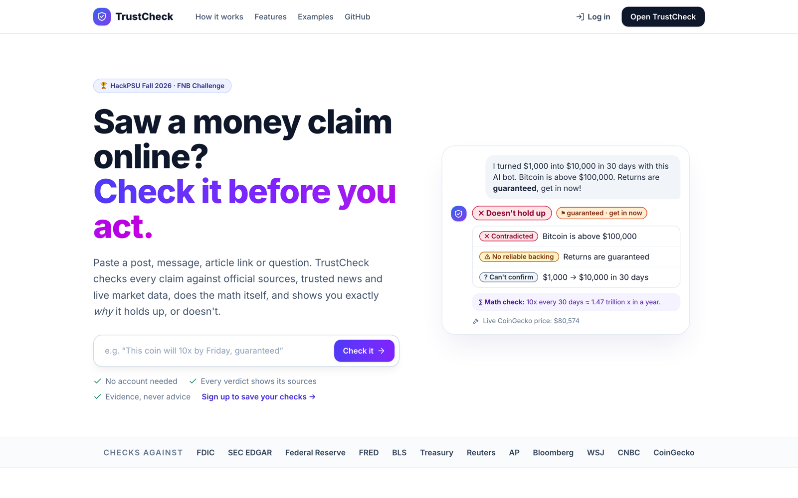

<table>
<tr>
<td width="50%">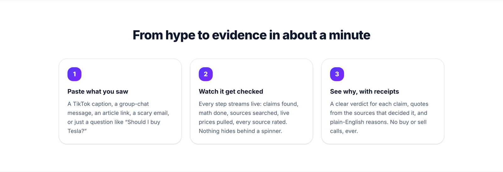<br/><sub><b>How it works.</b> Paste, watch every step, see the receipts</sub></td>
<td width="50%">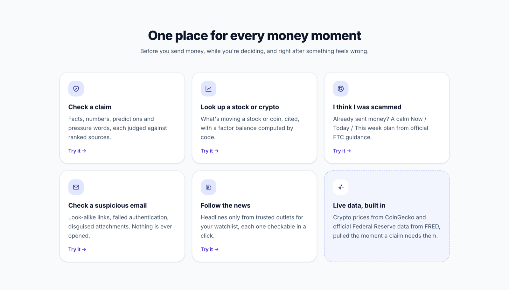<br/><sub><b>One place for every money moment.</b> Five modes, plus live data</sub></td>
</tr>
<tr>
<td>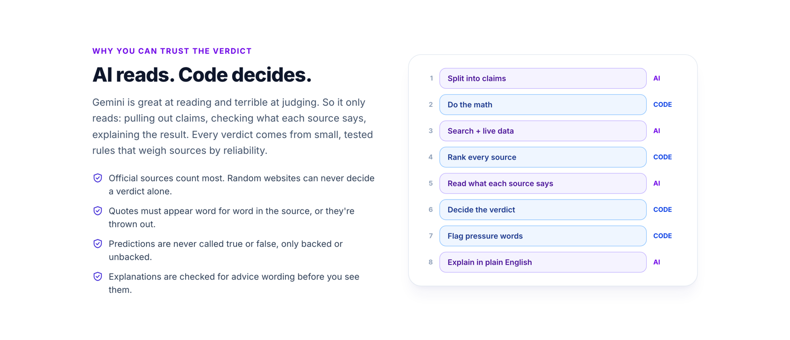<br/><sub><b>AI reads. Code decides.</b> Which steps are AI and which are fixed rules</sub></td>
<td>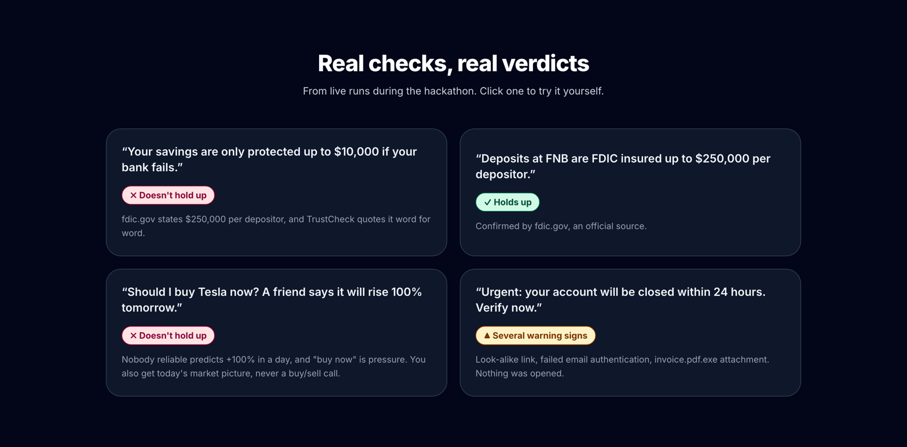<br/><sub><b>Real checks, real verdicts.</b> Click one to run it</sub></td>
</tr>
<tr>
<td>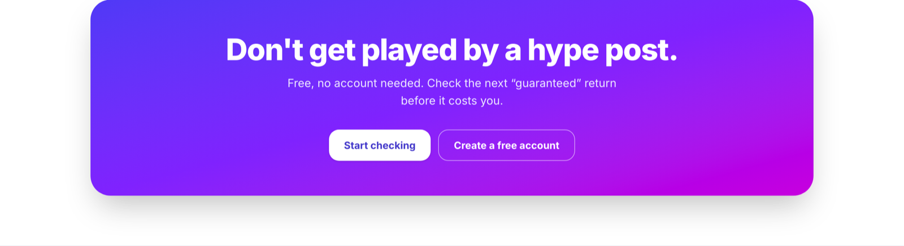<br/><sub><b>Start checking</b> or create a free account</sub></td>
<td>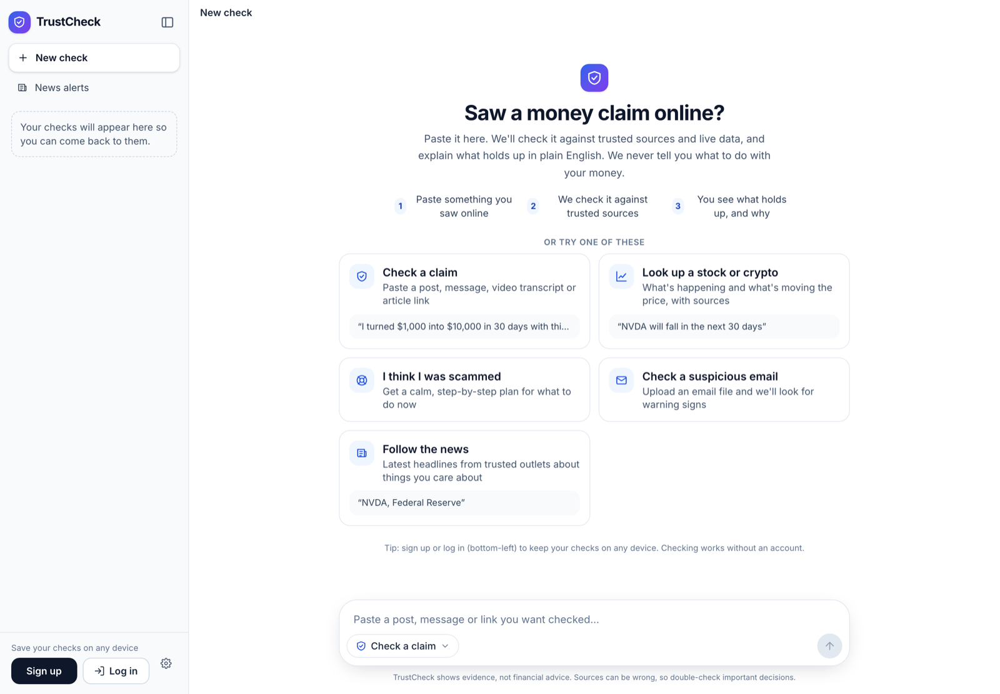<br/><sub><b>Inside the app.</b> The welcome screen, with Sign up / Log in at the bottom left</sub></td>
</tr>
</table>

Open it locally at `http://localhost:5173/#/welcome`. First-time visitors see it automatically.

> [!IMPORTANT]
> **AI reads. Code decides.** Gemini extracts claims, reads sources and writes the plain-English explanation.
> Every verdict, score and label is produced by small, tested TypeScript functions, so the model can't "decide" that a scam is fine.

## See it in action

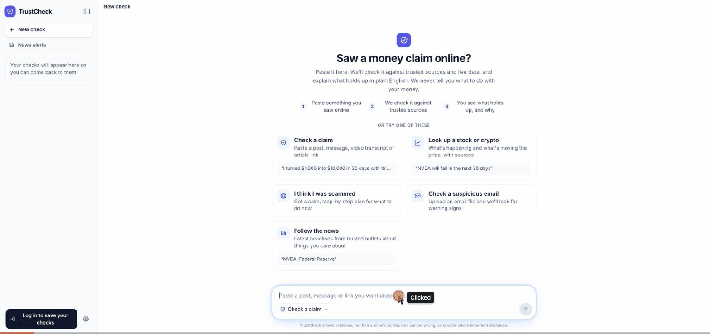

*"Should I buy Tesla now? A friend says it is going to rise 100% tomorrow": TrustCheck streams each step, finds no reliable source that makes the prediction, flags the "buy now" pressure, and adds today's market picture for TSLA with a bottom line built by code.*

### ▶️ Full 100-second demo

Hype post · "Should I buy?" · ScamSOS · email check · news alerts (sound off, captions on screen).

https://github.com/user-attachments/assets/7f44ea8d-5330-4f67-b255-c5ec32577fcd

<sub>Can't play it? [Download the MP4](docs/demo.mp4).</sub>

## Try these

Real results from live runs during the hackathon. Live search means wording and sources can vary from run to run.

| Paste this | TrustCheck says | Because |
|---|---|---|
| *"Your savings are only protected up to $10,000 if your bank fails. And the Fed's rate target is 5.5%."* | ❌ **Doesn't hold up** | fdic.gov states the $250,000 limit; Federal Reserve data contradicts the 5.5% |
| *"Deposits at First National Bank (FNB) are FDIC insured up to $250,000 per depositor."* | ✅ **Holds up** | fdic.gov confirms it, quoted word for word |
| *"FNB Corporation is headquartered in New York City."* | ❌ **Doesn't hold up** | The federal bank regulators' site (ffiec.gov) contradicts it |
| *"I turned $1,000 into $10,000 in 30 days with this AI bot. Bitcoin is above $100,000. Returns are guaranteed, get in now!"* | ❌ **Doesn't hold up** | Live CoinGecko price contradicts Bitcoin > $100k · "guaranteed returns" has no reliable backing · 3 pressure phrases · math card: 10x a month ≈ 1.47 trillion x a year |
| *"Should I buy Tesla now? A friend says it will rise 100% tomorrow."* | ❌ **Doesn't hold up** + 📈 market picture | No reliable source predicts +100% in a day (extraordinary) · "buy now" pressure · today's TSLA drivers and a code-built bottom line |
| *A phishing `.eml` file* | ⚠️ **Several warning signs** | A link that goes somewhere else · failed SPF/DMARC · `invoice.pdf.exe` · the "closed in 24 hours" threat has no reliable backing |

## Gallery

| | |
|:---:|:---:|
| 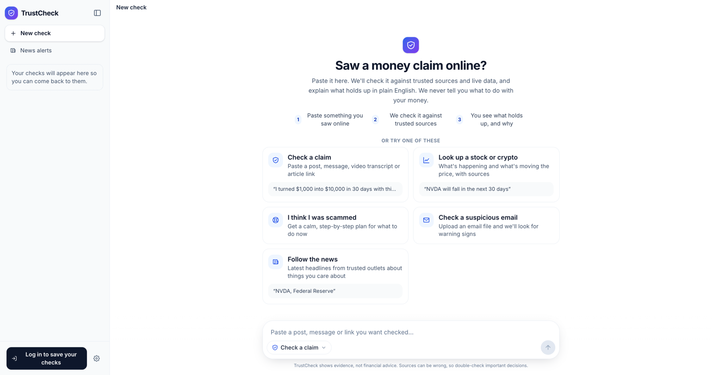<br/>**Five ways in.** Check a claim, look up a stock, get scam help, check an email, follow the news | 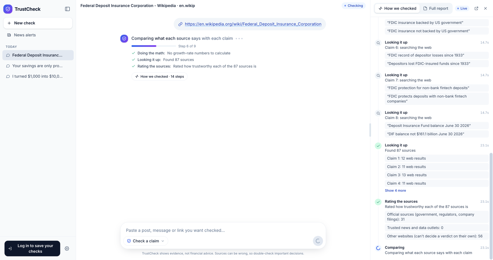<br/>**Never looks stuck.** Every step and tool call streams live in *How we checked* |
| 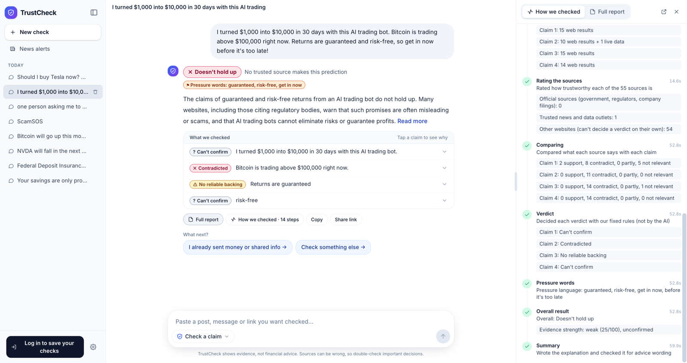<br/>**Verdict with reasons.** Each claim gets its own verdict; code decides the overall label | 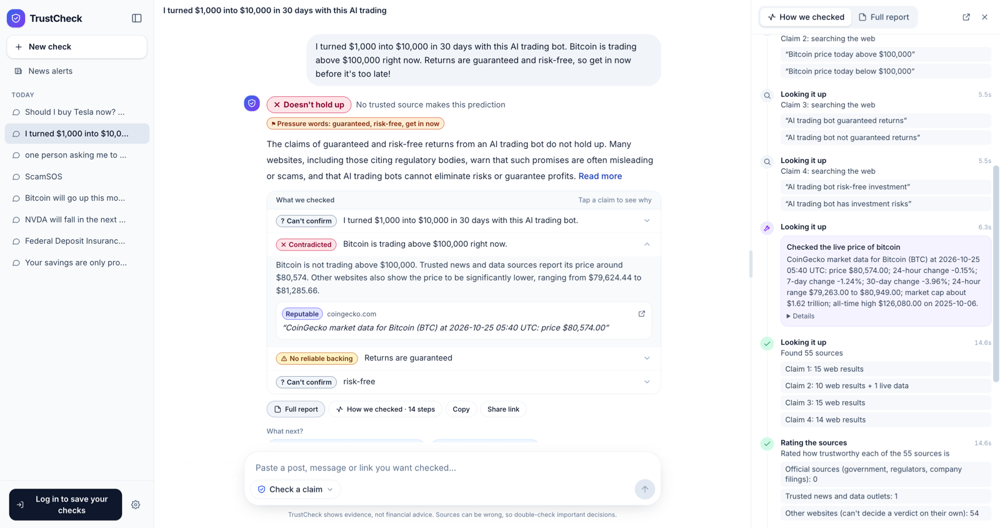<br/>**Tap any claim.** See the best source, quoted, plus the live data tool calls |
| 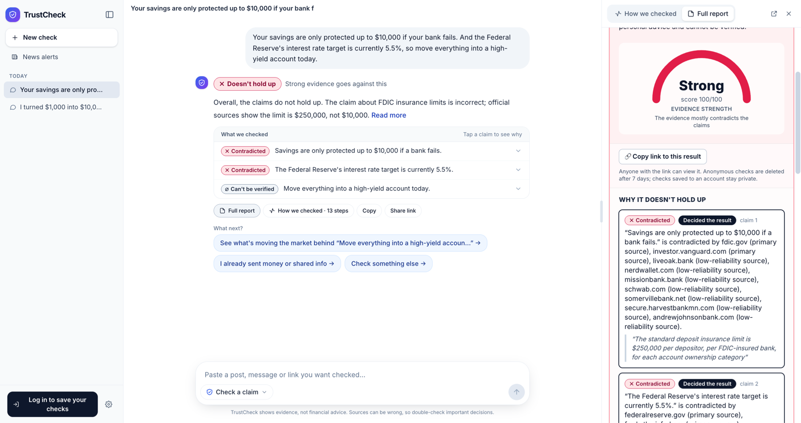<br/>**Official sources decide.** fdic.gov and the Fed contradict a false savings claim | 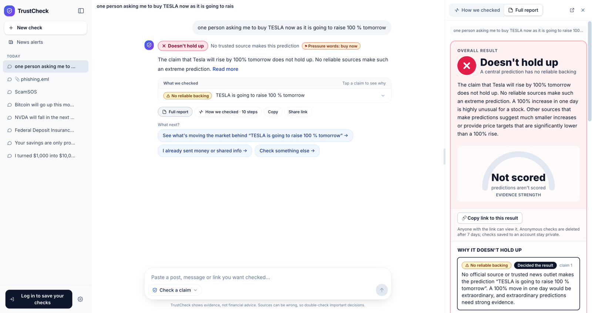<br/>**Predictions aren't true/false.** Nobody reliable predicts +100% tomorrow, so it doesn't hold up |
| 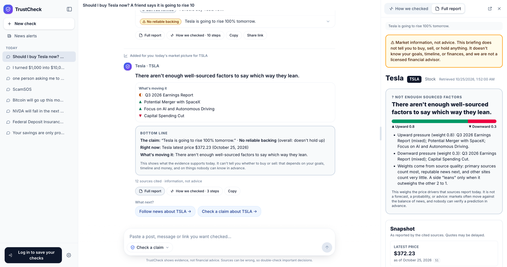<br/>**"Should I buy?"** Evidence plus today's market picture, never advice | 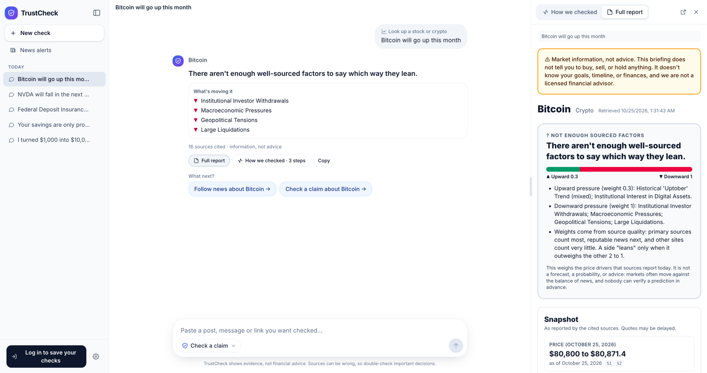<br/>**Market briefing.** Cited drivers and a factor balance computed by code |
| 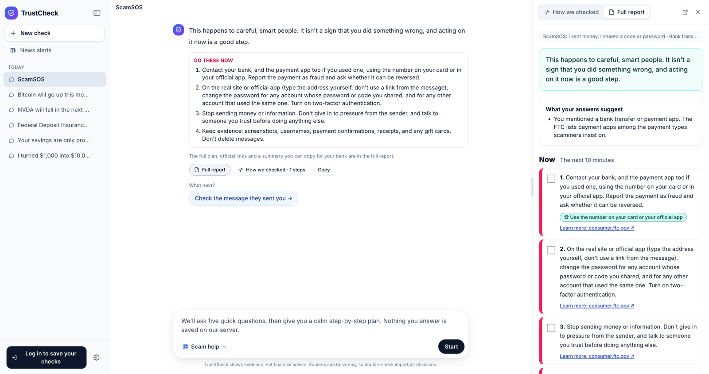<br/>**ScamSOS.** A calm plan; every step links to an official page | 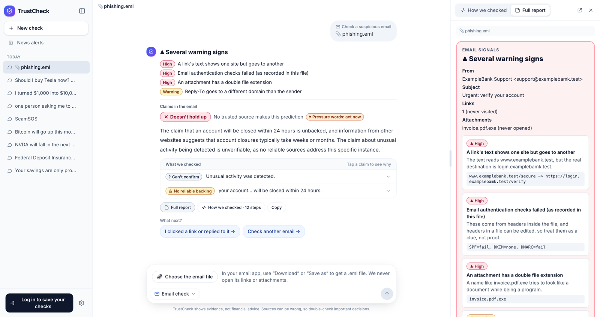<br/>**Email check.** Phishing signs found in code; links never visited |

---

### 📱 On your phone

The landing page, chat, report panel, menu and mode picker all adapt to phones and tablets: side panels become drawers, cards stack into one column, and nothing scrolls sideways.

| Landing | Ask | Verdict | Full report | Menu | Modes |
|:---:|:---:|:---:|:---:|:---:|:---:|
| 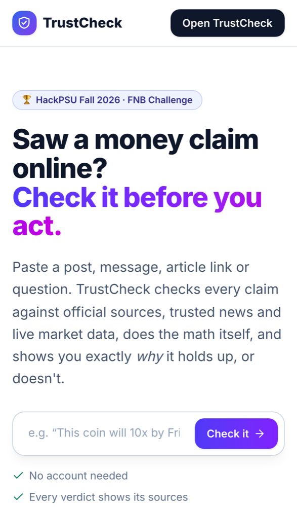 | 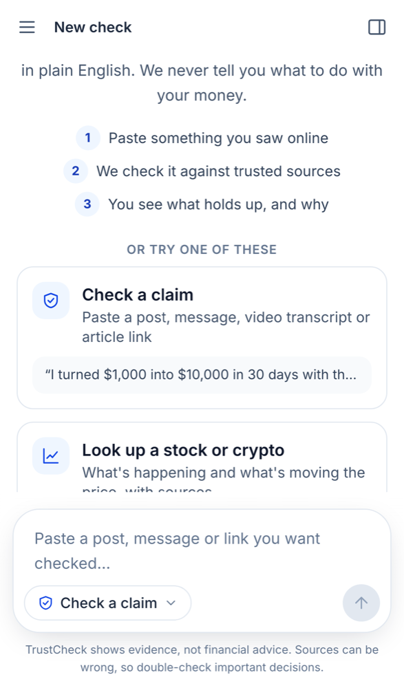 | 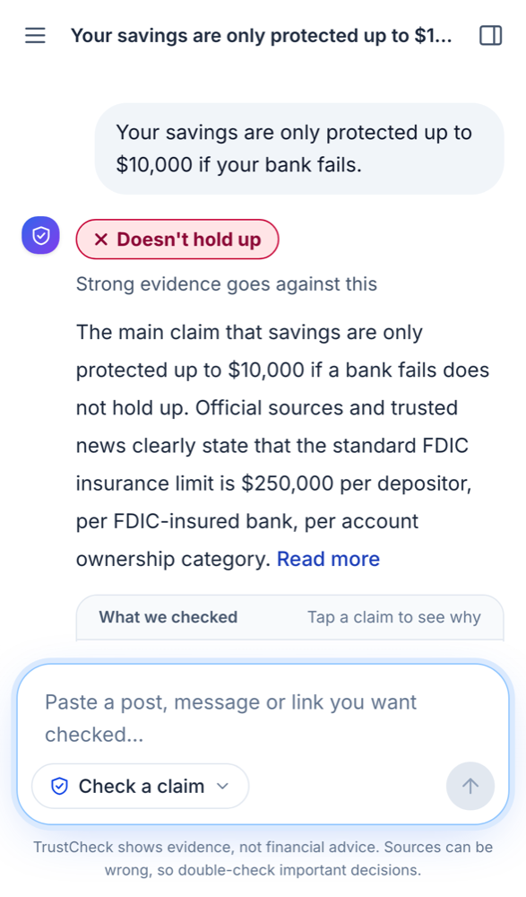 | 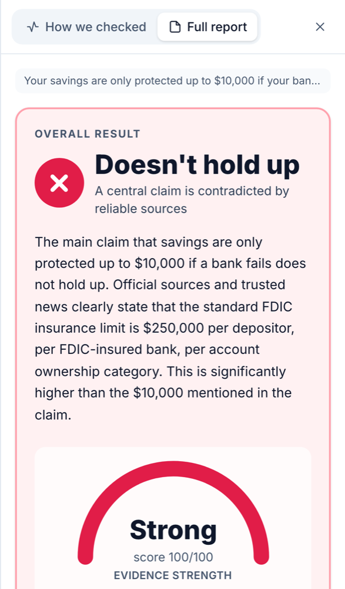 | 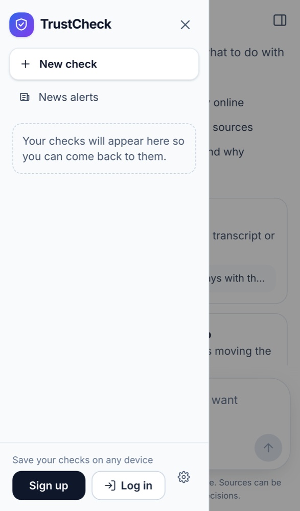 | 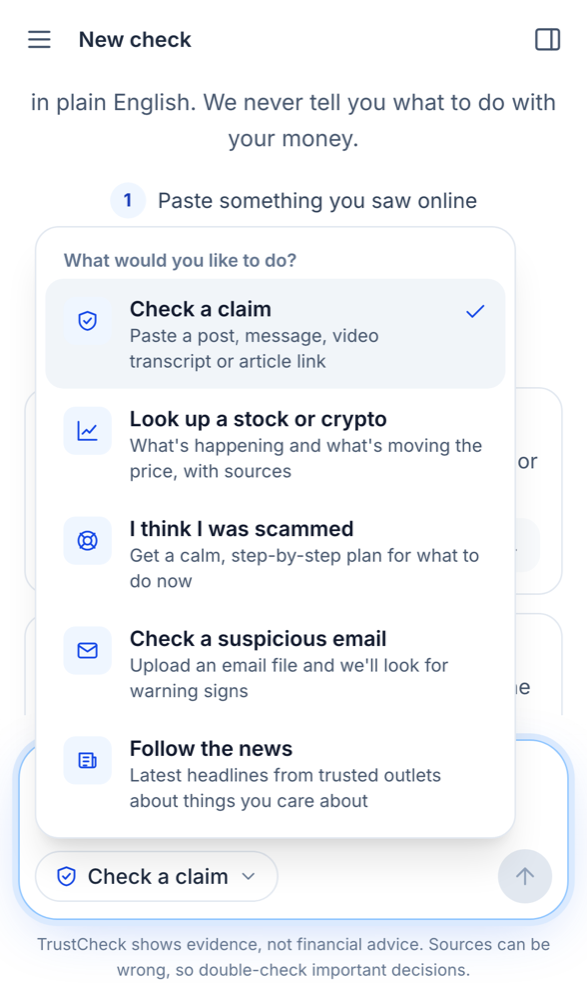 |

## Contents

- [Landing page and welcome screens](#landing-page-and-welcome-screens) · [See it in action](#see-it-in-action) · [Try these](#try-these) · [Gallery](#gallery)
- [What it does](#what-it-does)
- [Architecture](#architecture)
- [The claim-check pipeline](#the-claim-check-pipeline)
- [How verdicts are decided](#how-verdicts-are-decided)
- [Guardrails](#guardrails)
- [Tech stack](#tech-stack)
- [Repository layout](#repository-layout)
- [API](#api)
- [Getting started](#getting-started)
- [Configuration](#configuration)
- [Testing and evaluation](#testing-and-evaluation)
- [Security and privacy](#security-and-privacy)
- [FAQ](#faq)
- [Roadmap](#roadmap)
- [Limits](#limits)

---

## What it does

TrustCheck is a chat-style app with five modes, picked from the composer.

| Mode | What you give it | What you get |
|---|---|---|
| **Check a claim** | A post, message, video transcript, article link or question | Each claim labelled *Supported*, *Mixed*, *Contradicted* or *Can't confirm*. Predictions are never called true or false, only *Others predict this* or *No reliable backing*. You also get an overall result (*Holds up*, *Needs checking* or *Doesn't hold up*), an evidence-strength gauge, the reasons behind the result with quoted sources, math cards and pressure-language flags. |
| **Look up a stock or crypto** | A ticker, a company, or a prediction like "NVDA will fall this month" | A cited briefing: current figures, what is moving the price, fundamentals, analyst views, bull and bear points, upcoming events and risks. A **factor balance computed by code** says whether today's sourced factors lean toward, against, or are mixed on the prediction. |
| **I think I was scammed** (ScamSOS) | Five quick questions | A calm *Now / Today / This week* plan where every step links to an official page (FTC, FBI IC3), plus a case summary to copy for your bank. Nothing you answer is stored. |
| **Check a suspicious email** | A `.eml` file | Warning signs computed in code: a link that shows one site but goes to another, look-alike domains, failed authentication, disguised attachments and pressure wording. The email's own claims are also checked. Links are never visited and attachments are never opened. |
| **Follow the news** | Topics like `NVDA, Federal Reserve` | Headlines from the last 24 hours, only from trusted outlets, refreshed every 3 minutes while the app is open, each with a one-click *Check this headline*. |

Smart routing between modes:

- **"Should I buy X?" questions.** TrustCheck checks any prediction in the message and then automatically adds today's market picture for that asset. It ends with a **Bottom line** built by code from the claim's verdict, the current price and which way the sourced factors lean. It never says buy, sell or hold.
- **A question or statement typed in News mode** runs as a claim check instead of being followed as a topic.

The interface has three panels: chat history on the left; the conversation in the middle; on the right, *How we checked* (every step and tool call, streamed live) and *Full report*. Both side rails collapse, and the report panel can be resized. It also has dark mode, shareable result links (`#/check/<id>`), and optional Auth0 login to keep your history.

---

## Architecture

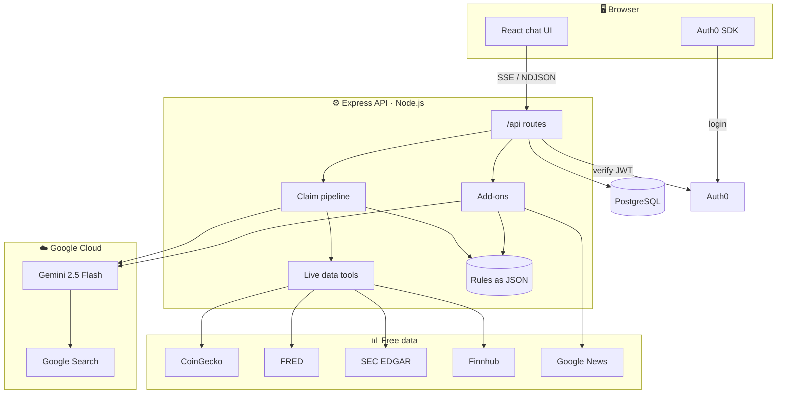

**How a check flows**

1. The browser POSTs the text or link to `/api/check`. The server starts the pipeline in the background and returns an id.
2. The browser opens `/api/check/:id/stream`, which uses Server-Sent Events. Every stage, search query and tool call is pushed as it happens, so the *How we checked* panel fills in live.
3. The result is saved to Postgres, or to an in-memory store if no `DATABASE_URL` is set. Logged-in users get it in their history; anonymous checks are deleted after 7 days.

Market briefings stream line by line as newline-delimited JSON (NDJSON) from `/api/market-brief/stream`.

---

## The claim-check pipeline

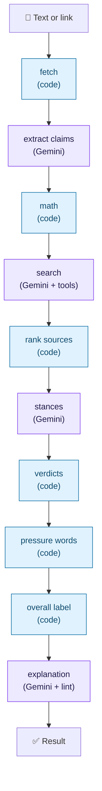

<sub>🟪 AI step · 🟦 code step</sub>

| Stage | Who | What happens | Where |
|---|---|---|---|
| **fetch** | code | Downloads an article link. Blocks private, loopback and cloud-metadata addresses at connect time, caps size at 3 MB, prefers the main `<article>`, and explains sites that block automated readers. | `pipeline/fetchUrl.ts`, `util/ssrf.ts` |
| **extract** | Gemini | Splits text into up to 8 claims, typed as *fact*, *numbers*, *forecast* or *opinion*, with importance, the asset it's about (e.g. TSLA), any stated numbers and timeframe, and 2 neutral search queries. Knows today's date, so 2026 events aren't treated as forecasts. | `pipeline/extractClaims.ts`, `prompts/extractClaims.ts` |
| **math** | code | "10x in 30 days" becomes ≈ 1.47 trillion x a year; "+100% tomorrow" becomes "$1,000 would become $2,000". | `pipeline/mathCheck.ts` |
| **search** | Gemini + code | Google Search grounding finds sources (Tavily or Brave can be added). In parallel, Gemini may request up to 3 **live data tool** calls from an allow-list; code validates the arguments and makes the requests. Opinions aren't searched. | `search/`, `tools/` |
| **rank sources** | code | Each domain is looked up in `sourceTiers.json`: **official** (Tier 1), **trusted news or data** (Tier 2) or **other website** (Tier 3). | `pipeline/tierSources.ts` |
| **stance** | Gemini | For each source: supports, contradicts, partly, or not relevant, with a quote that must appear word for word in the source text. For predictions, "supports" means a named source makes the same prediction. | `pipeline/classifyStance.ts` |
| **verdict** | code | Tier-weighted sums decide each claim (rules below). | `pipeline/verdict.ts` |
| **pressure language** | code | Matches terms like "guaranteed", "risk-free" and "get in now", and patterns like "buy … now". | `pipeline/hypeFlags.ts`, `config/hypeTerms.json` |
| **aggregate** | code | Overall label, evidence-strength gauge, and reasons citing the deciding sources. | `pipeline/aggregate.ts` |
| **explain** | Gemini + code | Plain-English "why". The text is rejected and retried if it contains advice wording, unknown source ids, internal jargon or garbled text; after retries it falls back to fixed templates. | `pipeline/explain.ts`, `pipeline/validators.ts` |

### Live data tools

| Tool | Source | Key needed | Used for |
|---|---|---|---|
| `get_crypto_price` | CoinGecko | no | Live crypto prices, 24h/7d/30d change, all-time high |
| `get_economic_series` | FRED (public CSV) | no | Fed funds target, CPI, unemployment and other official series |
| `get_stock_quote` | Finnhub | `FINNHUB_API_KEY` | Live US stock quotes |
| `search_sec_filings` | SEC EDGAR full-text search | `SEC_USER_AGENT` (contact string) | Company filings with excerpts |

Tool results become evidence with a *Live data* badge and go through the same stance and verdict rules as everything else.

---

## How verdicts are decided

All numbers live in [`server/src/config/thresholds.json`](server/src/config/thresholds.json) and are covered by tests.

**Source weights.** Official sources count 3, trusted news or data 2, other websites 0.5. Other websites are **capped at 1 in total** per side, so they can never decide a verdict alone. Each domain counts once per side.

**Fact claims.** `S` is the weighted support and `C` the weighted contradiction.

| Verdict | Rule |
|---|---|
| Supported | `S ≥ 3` and `C ≤ 1` |
| Contradicted | `C ≥ 3` and `S ≤ 1` |
| Mixed | Reliable sources address it, but neither rule above is met |
| Can't confirm | No official or trusted source addresses it |

**Predictions** are never true or false:

| Verdict | Rule |
|---|---|
| Others predict this | Reliable sources make a similar prediction (same `S`/`C` rule as *Supported*) |
| No reliable backing | No official source or trusted outlet backs it |
| Can't be verified | Reliable sources disagree about the outlook, or the claim is an opinion |

**Overall label**, based on the most important claims:

| Label | When |
|---|---|
| ❌ Doesn't hold up | A central claim is contradicted, **or** a central prediction has no reliable backing and is extraordinary (a move of at least 25% within 30 days) or pushed with pressure words |
| ⚠️ Needs checking | A central claim is unconfirmed or mixed, or there are 3 or more pressure terms |
| ✅ Holds up | Every central claim is supported and there is at most 1 pressure term |

The **evidence-strength gauge** shows how decisive the reliable evidence is, whichever way it points: clearly contradicted scores as high as clearly supported. A line under it shows the direction.

The **market factor balance** weighs sourced up and down price drivers by source tier. A side "leans" only when it outweighs the other 2 to 1 and enough well-sourced factors exist. It reports direction only: no price targets, no probabilities, no advice.

---

## Guardrails

- **Advice is blocked in code.** Explanations are linted for "buy", "sell", "you should" and similar wording, and rejected text is regenerated or replaced with a fixed template. Every result and briefing carries a not-advice notice.
- **No invented sources.** Quotes must appear verbatim in the retrieved text. Cited evidence ids must exist. In market briefings, every number must appear in the source text, and a citation only counts if the sentences Google linked to that source match the item.
- **Prompt-injection resistant.** Pasted, fetched and emailed content is wrapped as data, and prompts tell the model to ignore instructions inside it. Verdicts never depend on model judgement.
- **Validated model output.** Every Gemini response is parsed against a zod schema. Invalid output is retried with the validation error fed back.
- **ScamSOS can't make promises.** Steps come from a rules file where each one links to an official page. The model may only reword them, and a guard rejects rewordings that add links, numbers or promises of getting money back. `npm run check:playbook -w server` validates the file.
- **Plain language for everyone.** Results never say "tier" or show internal codes; prompts and validators enforce this.

---

## Tech stack

| Layer | Technology | Purpose |
|---|---|---|
| **Frontend** | [React 18](https://react.dev), [TypeScript](https://www.typescriptlang.org), [Vite 5](https://vitejs.dev) | Single-page chat app |
| | [Tailwind CSS v4](https://tailwindcss.com) | Styling, container queries for the resizable report panel, dark mode via palette remapping |
| | [Auth0 React SDK](https://github.com/auth0/auth0-react) | Login and access tokens |
| | Server-Sent Events, NDJSON streaming | Live progress for checks and market briefings |
| **Backend** | [Node.js 24](https://nodejs.org), [Express](https://expressjs.com), TypeScript via [tsx](https://tsx.is) | REST + streaming API |
| | [zod](https://zod.dev) | Request and AI-output validation |
| | [Helmet](https://helmetjs.github.io), [express-rate-limit](https://github.com/express-rate-limit/express-rate-limit), [cors](https://github.com/expressjs/cors) | Security headers, rate limiting |
| | [undici](https://github.com/nodejs/undici) | Guarded URL fetching with connect-time address checks |
| | [jose](https://github.com/panva/jose) | Auth0 JWT verification |
| | [mailparser](https://nodemailer.com/extras/mailparser/), [multer](https://github.com/expressjs/multer) | In-memory `.eml` parsing |
| **AI** | **Gemini 2.5 Flash on Google Cloud Vertex AI** via [google-auth-library](https://github.com/googleapis/google-auth-library-nodejs) | Claim extraction, stance, explanations, market notes (structured JSON output with schemas) |
| | **Google Search grounding** | Source retrieval for claims and market briefings |
| | **Gemini function calling** | Picks live data tools from an allow-list |
| | Tavily, Brave Search (optional) | Alternative search providers |
| **Data** | [CoinGecko](https://www.coingecko.com/en/api), [FRED](https://fred.stlouisfed.org), [SEC EDGAR](https://www.sec.gov/edgar), [Finnhub](https://finnhub.io), [Google News RSS](https://news.google.com) | Live prices, official economic data, filings, headlines |
| **Storage** | [PostgreSQL](https://www.postgresql.org) via [pg](https://node-postgres.com) | Saved checks, history, 24-hour search cache (in-memory fallback for local dev) |
| **Auth** | [Auth0](https://auth0.com) | Optional login; history is owner-only |
| **Testing** | [Vitest](https://vitest.dev) | 224 unit and integration tests |
| **Tooling** | npm workspaces, dotenv | Monorepo, configuration |

---

## Repository layout

```
.
├── client/                      React app
│   └── src/
│       ├── App.tsx              Chat shell: chats, modes, runs, follow-ups, auto market context
│       ├── Sidebar.tsx · Rails.tsx        History, settings, collapsible rails, resize handle
│       ├── Composer.tsx         Input box + mode picker
│       ├── TurnView.tsx         One question/answer turn (summary, claims, bottom line)
│       ├── Activity.tsx         "How we checked" live panel
│       ├── Results.tsx          Full report (gauge, reasons, claims, evidence)
│       ├── Market.tsx · ScamSOS.tsx · EmailCheck.tsx · News.tsx · Implication.tsx
│       ├── api.ts · newsStore.ts · chat.ts · labels.ts · Auth.tsx · Theme.tsx
│       └── index.css            Tailwind theme, motion, dark palette
├── server/
│   ├── src/
│   │   ├── index.ts             Express app, security middleware, purge job
│   │   ├── routes/api.ts        /check, /check/:id(/stream), /history
│   │   ├── runner.ts            Runs checks, streams progress, maps errors to plain words
│   │   ├── pipeline/            fetchUrl · extractClaims · mathCheck · tierSources · classifyStance
│   │   │                        verdict · hypeFlags · aggregate · explain · validators · calculators
│   │   ├── prompts/             All Gemini prompts and response schemas
│   │   ├── llm/                 Vertex AI client + schema-validated JSON calls with retries
│   │   ├── search/              Gemini Google Search grounding (+ Tavily/Brave adapters)
│   │   ├── tools/               Live data tools: CoinGecko, FRED, SEC, Finnhub + planner
│   │   ├── addons/              market · scamsos · emailCheck · news · calculators · feature flags
│   │   ├── config/              sourceTiers · thresholds · hypeTerms · playbook · brandDomains (JSON)
│   │   ├── db/                  Postgres store (+ in-memory fallback)
│   │   └── util/ssrf.ts         Private/metadata address detection
│   └── test/                    Vitest suites + email fixtures
├── eval/                        Claim evaluation set and demo cache inputs
└── docs/
    ├── ASSUMPTIONS.md           Every judgement call and spec deviation
    ├── DEVPOST.md               Submission write-up
    └── demo.gif · demo.mp4
```

---

## API

All routes are under `/api`.

| Method | Route | Description |
|---|---|---|
| `GET` | `/health` | Liveness check |
| `GET` | `/features` | Which add-ons are switched on |
| `POST` | `/check` | Start a check (`{ text }` or `{ url }`), returns `{ id }` |
| `GET` | `/check/:id/stream` | Server-Sent Events: stage progress, search queries, tool calls, final result |
| `GET` | `/check/:id` | Saved result (shareable link) |
| `DELETE` | `/check/:id` | Delete your own saved check (Auth0) |
| `GET` | `/history` | Your saved checks (Auth0) |
| `POST` | `/market-brief` · `/market-brief/stream` | Market briefing (JSON or NDJSON stream) |
| `POST` | `/scamsos` | Build a ScamSOS plan from the five answers |
| `POST` | `/email-check` | Upload a `.eml` (multipart) for signals + claim check |
| `POST` | `/news` | Latest reliable headlines for up to 10 topics |
| `POST` | `/calculate` | "What this implies" calculators |

---

## Getting started

**Prerequisites:** Node.js 20+ (developed on 24), a Google Cloud project with the Vertex AI API enabled, and the [gcloud CLI](https://cloud.google.com/sdk/docs/install). PostgreSQL is optional.

```bash
git clone https://github.com/karbaz017/trustcheck.git
cd trustcheck
npm install

cp .env.example .env                    # set GOOGLE_CLOUD_PROJECT, GOOGLE_CLOUD_LOCATION, GEMINI_MODEL
gcloud auth application-default login   # Vertex AI credentials (ADC), no API key needed

npm run dev:server                      # API on http://localhost:8787
npm run dev:client                      # app on http://localhost:5173 (proxies /api)
```

To switch on the full app, set the feature flags in `.env`: `FEATURE_MARKET`, `FEATURE_SCAMSOS`, `FEATURE_EMAIL_CHECK`, `FEATURE_NEWS`, `FEATURE_LIVE_DATA` and `FEATURE_CALCULATORS`, each to `true`.

**Optional extras**

- **Postgres:** `createdb trustcheck_dev`, then `DATABASE_URL=postgresql://localhost:5432/trustcheck_dev`. Tables are created on startup.
- **Auth0:** `AUTH0_DOMAIN` and `AUTH0_AUDIENCE` on the server; `VITE_AUTH0_DOMAIN`, `VITE_AUTH0_CLIENT_ID` and `VITE_AUTH0_AUDIENCE` in `client/.env`.
- **Live stock quotes and SEC filings:** `FINNHUB_API_KEY`, and `SEC_USER_AGENT="TrustCheck your-email@example.com"`.

> If checks fail with "Google Cloud login expired", run `gcloud auth application-default login` again and restart the server.

---

## Configuration

**Environment** (see [`.env.example`](.env.example))

| Variable | Purpose |
|---|---|
| `GOOGLE_CLOUD_PROJECT`, `GOOGLE_CLOUD_LOCATION`, `GEMINI_MODEL` | Vertex AI project, region (e.g. `us-central1`) and model (e.g. `gemini-2.5-flash`) |
| `SEARCH_PROVIDERS` | Search order, default `gemini`; options `gemini,tavily,brave` |
| `TAVILY_API_KEY`, `BRAVE_API_KEY` | Only if those providers are enabled |
| `DATABASE_URL` | Postgres connection; empty means an in-memory store |
| `AUTH0_DOMAIN`, `AUTH0_AUDIENCE` | Enable login and history |
| `FEATURE_*` | Add-on flags, all off by default |
| `FINNHUB_API_KEY`, `SEC_USER_AGENT` | Turn on the stock-quote and SEC tools |
| `PORT`, `APP_ORIGIN` | Server port and allowed browser origin |

**Rules as data** (`server/src/config/`)

| File | Controls |
|---|---|
| `sourceTiers.json` | Which domains count as official (e.g. `.gov`, SEC, Federal Reserve, FDIC, exchanges, company investor sites) or trusted news and data (e.g. Reuters, AP, Bloomberg, WSJ, CNBC, CoinGecko) |
| `thresholds.json` | Source weights, verdict cut-offs, label rules, gauge bands, the "extraordinary prediction" limits, factor-balance ratio |
| `hypeTerms.json` | Pressure words and patterns |
| `playbook.json` | ScamSOS steps and their official links |
| `brandDomains.json` | Brands to watch for look-alike email domains |

---

## Testing and evaluation

```bash
npm test                                   # 224 Vitest tests
npm run check:cli -w server -- "claim"     # one-off check from the terminal (prints the full JSON result)
npm run eval                               # runs eval/claims.json (see eval/README.md)
npm run demo:warm                          # pre-runs eval/demo.json into the demo cache
npm run check:playbook -w server           # validates the ScamSOS rules file
```

Tests cover source tiers, every calculator, verdict and label rules (including predictions), the evidence gauge, quote and citation validators, the advice lint, redaction, URL-fetch safety (SSRF), email fixtures, all ScamSOS scenarios, the market and news parsers, and the live tools with mocked network calls.

Every judgement call and deviation from the original spec is logged in [`docs/ASSUMPTIONS.md`](docs/ASSUMPTIONS.md).

---

## Security and privacy

- **No secrets in the repo.** Keys live in `.env` (gitignored), and Vertex AI uses Application Default Credentials.
- **Safe URL fetching.** The fetcher blocks private, loopback, link-local and cloud-metadata addresses at connect time, and caps response size.
- **Email.** Files are processed in memory only. Personal data is redacted before any AI call, and links and attachments are never opened.
- **Storage.** Anonymous checks are deleted after 7 days by an hourly purge. Saved checks are visible and deletable only by their owner (Auth0 JWT verified server-side). ScamSOS answers are never stored.
- **Abuse protection.** Requests are rate-limited, and Helmet sets security headers.
- **Fair data access.** Sources that block automated readers are explained to the user, not worked around. The SEC tool stays off until a contact string identifies the app.

---

## FAQ

<details>
<summary><b>Isn't this just asking a chatbot whether something is true?</b></summary>

No. The model never decides a verdict. Gemini reads text and labels how each source relates to a claim; verdicts come from fixed, tested rules that weigh sources by reliability (see [How verdicts are decided](#how-verdicts-are-decided)). A pile of random blogs can never outvote one official source, and a source the system didn't actually retrieve can never be cited.
</details>

<details>
<summary><b>Will it tell me whether to buy a stock?</b></summary>

No, by design. Ask "Should I buy X?" and you get the evidence: whether any prediction in your message is backed, today's cited market drivers, and which way they lean. TrustCheck never says buy, sell or hold. That decision depends on your goals, timeline and money, which it doesn't know.
</details>

<details>
<summary><b>How can it judge a prediction if the future can't be verified?</b></summary>

It doesn't call predictions true or false. It checks whether official sources or trusted outlets make the same prediction. If nobody reliable does, and the claim is extraordinary (at least 25% in 30 days or less) or comes with "buy now" pressure, it doesn't hold up. That's a common scam pattern.
</details>

<details>
<summary><b>Is it a fraud detector?</b></summary>

It spots common warning signs: pressure language, unbacked "guaranteed" returns, phishing tricks in emails. ScamSOS helps if you've already sent money. It can't verify whether a person, phone number or account is real, and it doesn't block anything.
</details>

<details>
<summary><b>Where does the data come from?</b></summary>

- **Google Search** through Gemini grounding.
- **Live market and economic data:** CoinGecko, FRED (Federal Reserve) and SEC EDGAR; Finnhub with a free key.
- **News:** Google News RSS, filtered to trusted outlets.

Every source is ranked by [`sourceTiers.json`](server/src/config/sourceTiers.json).
</details>

<details>
<summary><b>What happens to what I paste?</b></summary>

- **Anonymous checks** are deleted after 7 days.
- **Logged-in checks** are visible only to you, and you can delete them.
- **Emails** are processed in memory, with personal details removed before any AI call.
- **ScamSOS answers** are never stored.
</details>

## Roadmap

- [ ] Browser extension: right-click any selected text → *Check with TrustCheck*
- [ ] Count a company's own website as an official source for facts about that company (e.g. fnb-online.com for FNB)
- [ ] Price and claim trends over time (time-series storage), e.g. "this scam phrase was checked 14 times this week"
- [ ] Public deployment and a shareable demo link
- [ ] SEC filings and live stock quotes on by default
- [ ] Email/SMS alerts for the watchlist, more languages
- [ ] Publish the accuracy table from `eval/claims.json`

## Limits

TrustCheck is informational only.

- Search results and sources can be wrong, incomplete or out of date.
- Live results vary between runs.
- A well-supported claim doesn't make something a good decision for you.
- Predictions can't be verified by anyone.
- It doesn't verify people, phone numbers or accounts.

## License

[MIT](LICENSE)
